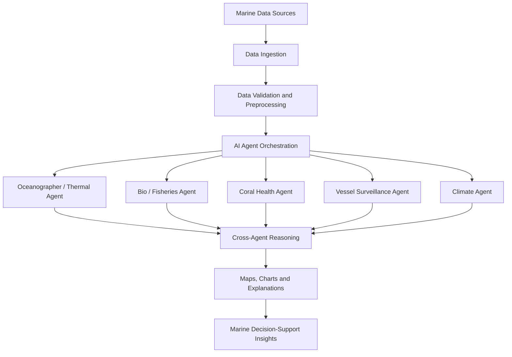

# ORCA — Marine EcOsystem Reasoning with Collaborative Agents

**Turning scattered marine data into connected, explainable ocean insights.**

ORCA is a multi-agent marine intelligence platform designed to bring oceanographic, satellite, environmental and vessel-related information into one place. It helps users understand marine conditions by combining observations that are often analysed separately.

**Hackathon:** Smart India Hackathon 2026  
**Organization:** ISRO  
**Problem Statement ID:** 26176

> **Project Status:** This README describes the project concept and intended architecture. Update feature status, screenshots, dataset references and setup commands to match what is actually implemented. Do not describe planned integrations as working live features.

https://orcamarineecosysytem.netlify.app/#/
---

## 📌 Contents

- The Problem
- Our Approach
- How ORCA Works
- Specialized AI Agents
- Key Features
- Technology Stack
- Data Sources and Scientific Notes
- Project Structure
- Getting Started
- Configuration and Security
- Responsible Use
- Future Scope
- Team and License

---

## 🌊 The Problem

Marine information is available from many different sources. Sea Surface Temperature (SST), chlorophyll concentration, coral heat-stress indicators, weather conditions and vessel activity each provide important information about the ocean.

However, these observations are often stored and analysed separately. Researchers, fisheries teams, conservation groups and maritime authorities may need to check several sources to understand what is happening in one marine area.

Looking at only one parameter can also give an incomplete picture. For example, chlorophyll can indicate biological productivity, but it does not directly tell us how many fish are present.

## 💡 Our Approach

ORCA connects different types of marine information through a collaborative multi-agent architecture.

Each specialized agent focuses on a particular area. An orchestration layer coordinates the agents, compares their findings and presents related information together.

ORCA aims to support:

- Potential Fishing Zone (PFZ) analysis
- Ocean condition and ecosystem monitoring
- Coral heat-stress and bleaching-risk assessment
- Vessel activity monitoring
- Climate-related marine analysis

ORCA is a decision-support platform. It does not replace field research, official forecasts or decisions made by authorized authorities.

---

## ⚙️ How ORCA Works

The general workflow of ORCA is:



### Workflow in Simple Words

1. **Collect:** Bring together ocean, satellite, environmental and vessel observations.
2. **Check:** Validate units, coordinates, timestamps and data quality.
3. **Analyse:** Send suitable information to the specialized agents.
4. **Connect:** Compare findings to understand how different observations relate.
5. **Present:** Display maps, charts, summaries and supporting data.
6. **Review:** Help users interpret the evidence and make informed decisions.

---

## 🤖 Specialized AI Agents

| Agent | Main Responsibility |
|---|---|
| Oceanographer / Thermal Agent | Analyses SST, temperature anomalies and thermal patterns. |
| Bio / Fisheries Agent | Analyses chlorophyll-a and marine productivity indicators. |
| Coral Health Agent | Examines temperature conditions and coral heat-stress indicators. |
| Vessel Surveillance Agent | Reviews available AIS observations, vessel positions and activity patterns. |
| Climate Agent | Examines climate indicators, long-term trends and large-scale ocean conditions such as ENSO. |

### Collaborative Analysis

The agents are designed to work together rather than provide isolated results.

For example, an ocean-area assessment may combine temperature conditions, chlorophyll concentration and available vessel observations to provide a broader understanding of the selected region.

---

## 🚀 Key Features

These are intended project capabilities. Mark features as completed only after implementation and testing.

- **Marine Data Integration:** Brings different marine datasets into a common workflow.
- **Multi-Agent Analysis:** Routes information to specialized agents based on the task.
- **Potential Fishing Zone Support:** Explores chlorophyll, SST and other available oceanographic conditions together.
- **Coral Stress Monitoring:** Reviews temperature-based heat-stress indicators.
- **Vessel Activity Review:** Visualizes available vessel observations and highlights unusual patterns for human review.
- **Interactive Visualization:** Presents supported data through maps, charts and time-based views.
- **Explainable Results:** Shows the observations, sources and context behind insights wherever available.
- **Role-Based Information:** Organizes information for researchers, fisheries teams, conservation groups and maritime operators.

---

## 💻 Technology Stack

| Area | Technologies |
|---|---|
| Programming Language | Python |
| Backend | FastAPI, REST APIs |
| Agent Orchestration | LangGraph |
| AI / ML | PyTorch, Hugging Face |
| Map Visualization | Leaflet |
| Geospatial Processing | Raster, Vector and Coordinate-Based Processing |
| Data Formats | NetCDF, CSV, GeoJSON |
| Data Categories | Satellite, Oceanographic, Environmental and Vessel Data |

*Keep only the technologies that are actually used in the current codebase.*

---

## 🛰️ Data Sources and Scientific Notes

ORCA may use different data sources depending on availability, access and project requirements.

The main data categories include:

### 1. Sea Surface Temperature (SST)
Satellite or oceanographic temperature observations used to understand ocean temperature conditions and thermal patterns.

### 2. Chlorophyll-a
Ocean-colour observations used as an indicator of phytoplankton biomass and marine biological productivity.

### 3. Coral Heat Stress
Temperature-based indicators such as Coral Reef Watch HotSpot and Degree Heating Weeks (DHW), where suitable data is available.

### 4. Vessel Activity
AIS-based observations from an authorized and documented data provider.

### 5. Climate and Weather
Environmental and climate indicators used to understand broader marine conditions.

### Scientific Interpretation

- Chlorophyll-a indicates phytoplankton and biological productivity. It is not a direct measurement of fish abundance.
- A potentially productive fishing zone is an analytical indication, not a guarantee that fish will be present.
- Elevated SST or heat-stress indicators can suggest coral bleaching risk. They do not independently confirm that bleaching has occurred.
- A vessel without a matching AIS record is not automatically an illegal vessel.
- Satellite products may contain cloud cover, missing observations, quality limitations and processing delays.

For every displayed dataset, aim to include its provider, dataset name, observation date, units, resolution and quality information wherever available.

**Never label sample, simulated or historical data as live satellite or live vessel data.**

---

## 📁 Suggested Project Structure

Adapt this structure to the folders that actually exist in your repository.

```text
ORCA/
│
├── README.md
├── LICENSE
├── .gitignore
├── .env.example
├── requirements.txt
│
├── frontend/
│   ├── src/
│   ├── public/
│   └── package.json
│
├── backend/
│   ├── app/
│   │   ├── agents/
│   │   ├── api/
│   │   ├── services/
│   │   └── main.py
│   │
│   └── tests/
│
├── data/
│   └── README.md
│
├── docs/
├── screenshots/
└── notebooks/
```

---

## 🛠️ Getting Started

The following commands are examples. Confirm the actual paths and scripts in your repository before publishing.

### 1. Clone the Repository

```bash
git clone https://github.com/YOUR-USERNAME/ORCA.git
cd ORCA
```

### 2. Create a Python Virtual Environment

**Windows:**

```bash
python -m venv .venv
.venv\Scripts\activate
```

**macOS / Linux:**

```bash
python3 -m venv .venv
source .venv/bin/activate
```

### 3. Install Dependencies

```bash
pip install -r requirements.txt
```

### 4. Configure Environment Variables

Create a local `.env` file using `.env.example` as a guide. Add the required values on your own computer.

### 5. Start the Backend

If your FastAPI application is located at `backend/app/main.py`, one possible command is:

```bash
uvicorn app.main:app --reload --app-dir backend
```

API documentation is commonly available at:

```text
http://127.0.0.1:8000/docs
```

### 6. Start the Frontend

If your frontend uses npm:

```bash
cd frontend
npm install
npm run dev
```

Open the local URL displayed in your terminal.

---

## 🔐 Configuration and Security

Use `.env.example` to show the environment variables required by the application without including real credentials.

Example:

```env
APP_ENV=development
API_HOST=127.0.0.1
API_PORT=8000

# Add only if your application uses these services.
# OCEAN_DATA_API_KEY=
# AIS_PROVIDER_API_KEY=
# LLM_API_KEY=
```

**Important Security Rules:**

- Never upload your real `.env` file.
- Never publish API keys, passwords or access tokens.
- Keep private backend credentials on the server.
- Do not expose private secrets through frontend environment variables.

---

## 🛡️ Responsible Use and Limitations

ORCA is designed to help users explore marine information, not to make unsupported claims.

- Automated outputs should be treated as indicators that need context and expert review where appropriate.
- Keep original data sources and timestamps with derived results.
- Do not present a vessel anomaly as proof of illegal activity.
- Do not present a risk indicator as a confirmed event.
- Clearly separate observed data, model outputs, forecasts and simulated demonstrations.
- Follow dataset licences, provider terms and access restrictions.

---

## 🔭 Future Scope

- [ ] Document datasets used by each agent.
- [ ] Complete data validation and preprocessing workflows.
- [ ] Connect specialist agents to the orchestration layer.
- [ ] Add cross-agent analysis with source-linked explanations.
- [ ] Improve interactive maps and time-series visualization.
- [ ] Add role-oriented views for marine stakeholders.
- [ ] Test outputs against suitable reference data.
- [ ] Add reproducible setup instructions and project screenshots.

Update this checklist as development progresses.

---

## 👥 Team and Project Information

**Project Name:** ORCA – Marine EcOsystem Reasoning with Collaborative Agents

**Hackathon:** Smart India Hackathon 2026

**Organization:** ISRO

**Problem Statement ID:** 26176

**Institution:** Add your institution name.

**Team Members:** Add the confirmed names of your project team members.

---


**ORCA — Connecting marine observations for clearer, more informed ocean decisions.**

